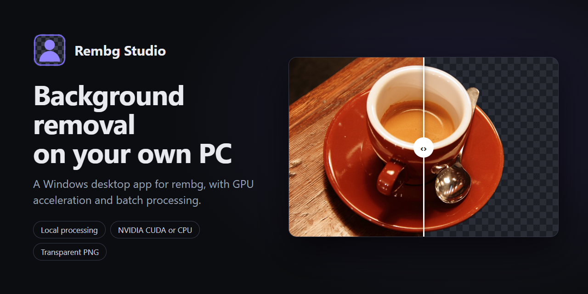
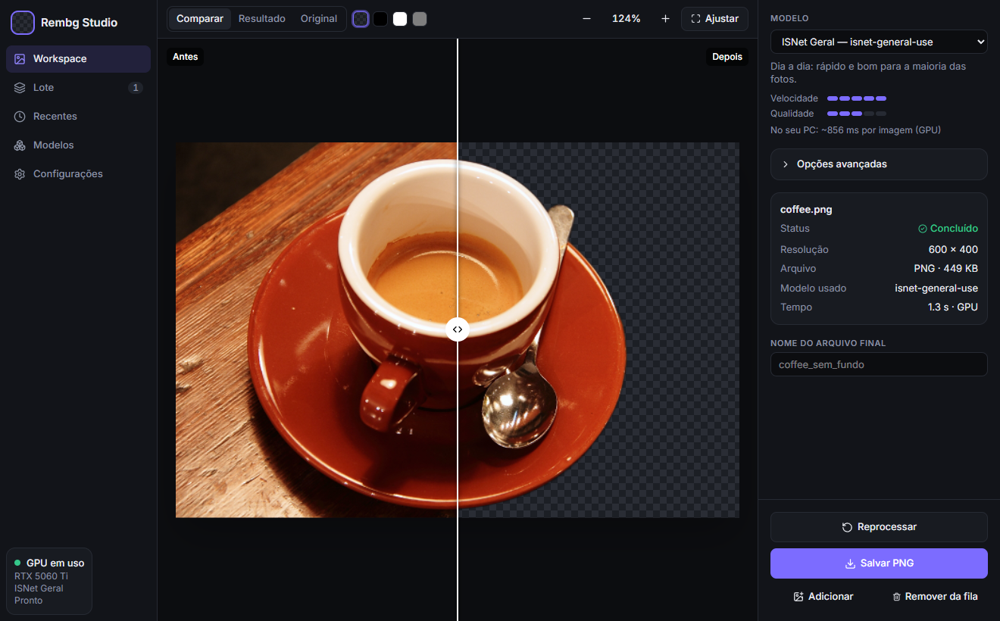
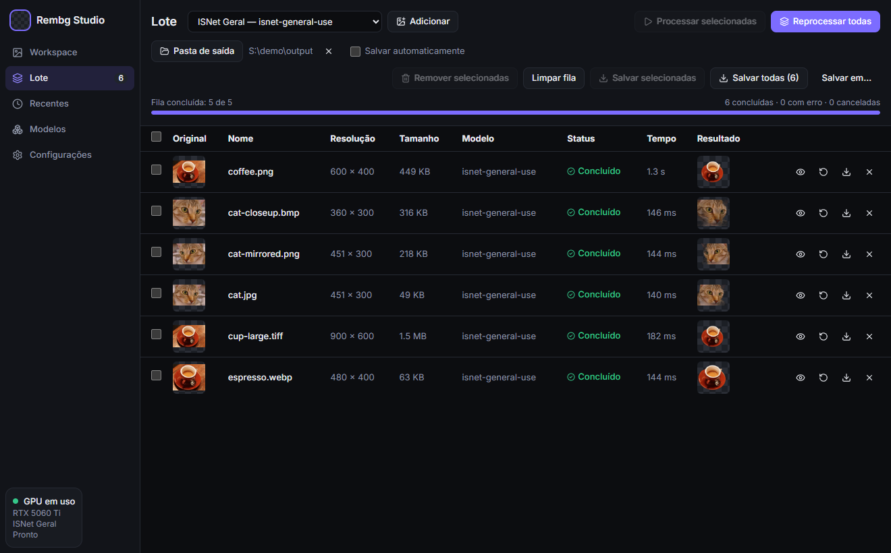
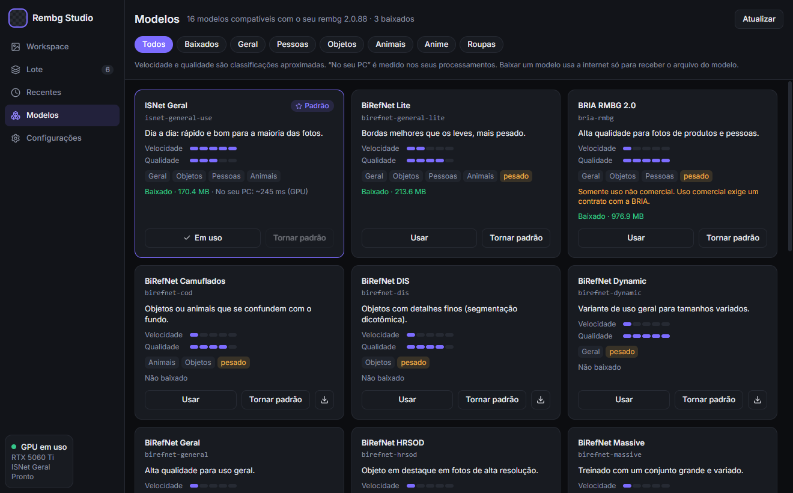
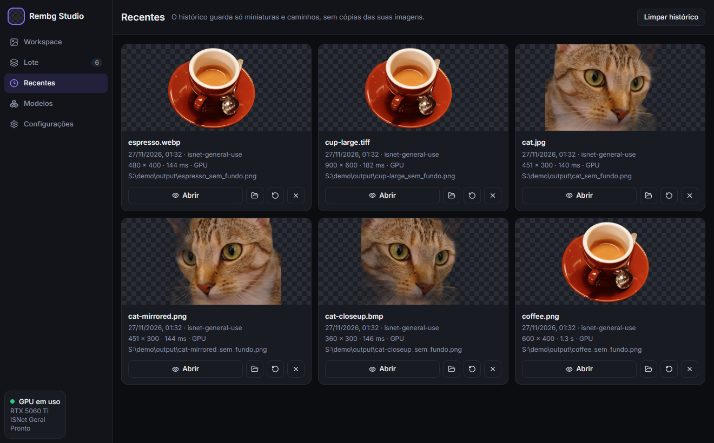
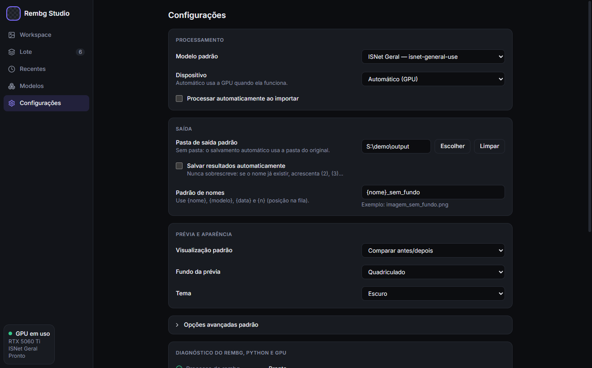
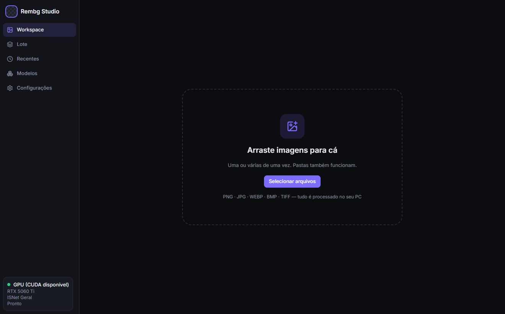

<p align="center">
  
</p>

# Rembg Studio

A Windows desktop app for background removal using [rembg](https://github.com/danielgatis/rembg), with GPU
acceleration and batch processing. Drop images in, compare before and after, and export transparent PNGs.
Images are processed on your computer and are not uploaded anywhere.

**English** · [Português (Brasil)](README.pt-BR.md)

> **The app's interface is in Brazilian Portuguese only.**
>
> **rembg is not bundled.** You install it once (see [Install](#install)); the app finds it and uses it.

## Features

- Drag and drop files or a folder (first level only), or use the file picker. PNG, JPEG, WebP, BMP and TIFF.
- Before/after slider, original and result views, zoom, pan, fit to screen.
- Preview backgrounds (checkerboard, black, white, gray). They never change the exported file.
- Batch view with thumbnails, resolution, size, model, status, time and result. One image is processed at a
  time, with one model loaded at a time.
- Cancel, retry and reprocess with another model.
- Model picker built from what your rembg installation reports.
- Advanced options: alpha matting, ViTMatte edge refinement, mask clean-up, color halo removal, mask-only export.
- PNG export with transparency. The embedded color profile (ICC) is kept for RGB sources.
- Output folder, file name pattern, per-image rename, auto-save. Existing files are not replaced without asking.
- Recent items history (thumbnails and file paths, not copies of your images).
- Diagnostics page with a real GPU test.

## Screenshots

| Before / after | Batch |
|---|---|
|  |  |
| **Models** | **Recent items** |
|  |  |
| **Settings** | **Start screen** |
|  |  |

## Requirements

- Windows 64-bit. **Tested only on Windows 11 Pro (build 26300).**
- rembg installed in a [uv](https://docs.astral.sh/uv/) tool environment (or another Python environment you point
  the app to). rembg 2.0.88 requires Python 3.11 or newer; the tested setup uses Python 3.12.
- For GPU acceleration: an NVIDIA GPU with a recent driver. **Tested only on an RTX 5060 Ti (16 GB),
  driver 621.x.** AMD and Intel GPU acceleration is not supported or tested.
- Disk space for models (the three used in testing take about 1.4 GB).

## Install

### 1. Install rembg

Install [uv](https://docs.astral.sh/uv/getting-started/installation/), for example:

```powershell
winget install astral-sh.uv
```

Then install **one** of the two variants.

NVIDIA GPU (downloads over 1 GB of CUDA libraries). These are the versions this app was tested with:

```powershell
uv tool install "rembg[gpu,cli]==2.0.88" --python 3.12 --with "onnxruntime-gpu[cuda,cudnn]==1.32.0"
```

CPU only (this package variant has not been tested with the app):

```powershell
uv tool install "rembg[cpu,cli]==2.0.88" --python 3.12
```

### 2. Get the app

From the [Releases](../../releases) page, pick one:

| File | What it is |
|---|---|
| `RembgStudio-Setup-1.0.0.exe` | Installer (per user, you choose the folder). **Not tested yet.** |
| `RembgStudio-1.0.0-portatil.exe` | Single portable file. It unpacks on every launch, so it starts a bit slower. |
| `RembgStudio-1.0.0-win-x64.zip` | Extract anywhere and run `Rembg Studio.exe`. |

The builds are **not code-signed**, so Windows SmartScreen may warn you. Verify your download against
`SHA256SUMS.txt`:

```powershell
Get-FileHash .\RembgStudio-1.0.0-portatil.exe -Algorithm SHA256
```

### 3. First run

The app looks for `%APPDATA%\uv\tools\rembg\Scripts\python.exe`, then asks `uv tool dir`. If rembg lives
somewhere else, open **Configurações → Diagnóstico → Escolher python.exe…**.

> Only choose a `python.exe` you trust: the app runs it.

## GPU and CPU

The CUDA libraries installed by pip live inside the rembg environment, where ONNX Runtime on Windows does not
find them by itself. The app adds those folders to `PATH` **for its own rembg process only**. It does not edit
your Python environment or system settings. (The plain `rembg` command line may still fall back to the CPU on
the same machine; that is outside this app.)

- **Configurações → Testar GPU de verdade** loads a model and reports where it actually ran. A listed CUDA
  provider alone does not prove the GPU works.
- If the GPU cannot be used, the app shows a warning and runs on the CPU, which is slower. The forced
  "CPU only" mode was tested on the GPU installation.
- Heavy models become much slower when other programs occupy video memory. On the test machine, with most of
  the 16 GB in use, large models took from several seconds to more than a minute per image.

## Models

With the default `gpu,cli` extras, rembg 2.0.88 exposes **16 local models** that the app lists:

`isnet-general-use` (default) · `isnet-anime` · `u2net` · `u2netp` · `u2net_human_seg` · `u2net_cloth_seg` ·
`silueta` · `birefnet-general` · `birefnet-general-lite` · `birefnet-portrait` · `birefnet-dis` ·
`birefnet-hrsod` · `birefnet-cod` · `birefnet-massive` · `birefnet-dynamic` · `bria-rmbg`

`birefnet-general-fp16` appears only if rembg's `fp16` extra is installed (not tested). Models that need your own
file or point prompts (`u2net_custom`, `dis_custom`, `ben_custom`, `sam`) and cloud services (`withoutbg`,
`atlascloud`) are intentionally left out.

**Only `isnet-general-use`, `birefnet-general-lite` and `bria-rmbg` were run during testing.** The speed and
quality bars in the app are rough, subjective ratings, not benchmarks. `u2net_cloth_seg` returns three cutouts
stacked vertically (upper body, lower body, full), so the before/after slider is not available for it.

### Downloading more models

A missing model is downloaded the first time you use it, or from the **Modelos** page (download button). From a
terminal:

```powershell
rembg d isnet-anime
```

Models are stored in `%USERPROFILE%\.rembg\models`. Downloads come from the URLs defined by rembg.
Downloading from inside the app has not been tested.

### Model licenses: read before using results commercially

**No model is included in this project or its releases.** Model weights have their own licenses, independent of
rembg's MIT license and of this app's MIT license. The table reports what the upstream pages stated when checked
on 2026-11-27. It is not legal advice.

| Model | Upstream | Code license | Weights license |
|---|---|---|---|
| `bria-rmbg` (RMBG 2.0) | [briaai/RMBG-2.0](https://huggingface.co/briaai/RMBG-2.0) | not applicable | ⚠️ **Non-commercial only** (CC BY-NC 4.0 in the model card; tagged `bria-rmbg-2.0`). **Commercial use requires an agreement with BRIA.** |
| `birefnet-*` | [ZhengPeng7/BiRefNet](https://github.com/ZhengPeng7/BiRefNet) | MIT | MIT on the main [Hugging Face page](https://huggingface.co/ZhengPeng7/BiRefNet); variant pages were not checked |
| `u2net`, `u2netp`, `u2net_human_seg` | [xuebinqin/U-2-Net](https://github.com/xuebinqin/U-2-Net) | Apache-2.0 | not stated |
| `silueta` | [U-2-Net issue 295](https://github.com/xuebinqin/U-2-Net/issues/295) (link given by rembg) | not verified | not stated / not verified |
| `u2net_cloth_seg` | [levindabhi/cloth-segmentation](https://github.com/levindabhi/cloth-segmentation) | MIT | not stated |
| `isnet-general-use` | [xuebinqin/DIS](https://github.com/xuebinqin/DIS) | Apache-2.0 | not stated; the DIS5K dataset has separate terms (not reviewed) |
| `isnet-anime` | [SkyTNT/anime-segmentation](https://github.com/SkyTNT/anime-segmentation) | Apache-2.0 | not stated in the repository README |
| ViTMatte (optional refinement) | [hustvl/ViTMatte](https://github.com/hustvl/ViTMatte) | MIT | not stated |

"Not stated" does **not** mean "free to use". Check with the authors if it matters for your work.

## Limitations

- **Alpha matting** runs on the CPU at full resolution and uses a lot of RAM: about 4 GB extra for a 12 MP
  image on the test machine (roughly 0.35 GB per megapixel). The app refuses images **over 25 MP**, or a lower
  limit when little RAM is free, instead of letting the PC stall. ViTMatte is not covered by this limit.
- Images over 250 megapixels are rejected.
- Only the first frame of multi-frame files is processed. 16-bit images are converted to 8-bit.
- Exported PNGs do **not** keep EXIF metadata. The ICC profile is kept only when the source is RGB; CMYK
  sources are converted without color management.
- **Results you have not saved are lost when you close the app:** the temporary cache is deleted the next time it
  starts (until then the files remain under `%APPDATA%\Rembg Studio\cache`). Turn on auto-save to keep them.
- Cancelling restarts the rembg process, so the next image reloads the model.
- The queue holds up to 1000 images and the history up to 300 entries.

## Privacy and local data

The app's own code makes no network requests, and there is no telemetry. rembg downloads model files when
needed. (Network traffic was not monitored with an external tool.)

Data is stored in `%APPDATA%\Rembg Studio`: settings, usage times per model, the history (**file paths of your
images** and **small thumbnails of results**), a temporary cache of results that is cleared at start-up, and
Electron's own profile files. **Limpar histórico** removes history entries and thumbnails; delete the folder to
remove everything. Your original images are never modified or deleted by the app.

## Status and testing

Everything below refers to version 1.0.0 on the single test machine described in Requirements.

**Tested automatically** against the app extracted from `RembgStudio-1.0.0-win-x64.zip` (built from a clean copy
of the source), with the real rembg installation and GPU (`tests/e2e.mjs`, 32 checks): start-up, import in the five formats, background removal, transparency of the
saved file, protection of originals, batch processing one at a time, existing-file handling, naming and rename,
switching models (`isnet-general-use`, `birefnet-general-lite`, `bria-rmbg`), the GPU test, forced CPU mode,
alpha matting, mask clean-up, halo removal and mask-only export, the matting size limit, the 250 MP limit, ICC profile,
the restrictions on which files and folders the app can open or reveal (Windows calls stubbed),
invalid and truncated files, an unknown model, a 6000×4000 image, cancel, a killed rembg process, auto-process
and auto-save, history, the model list, restart and persistence, no leftover Python processes after closing,
and start-up on a setup where rembg cannot be found (simulated by hiding it through environment variables).

**Simulated:** native open/save dialogs are replaced by stubs; drag and drop uses a drag event injected through
Chrome DevTools Protocol, not a real drag from Explorer.

**Partially tested:** the portable `.exe` was only launched (rembg started) and closed. The CUDA DLL loading
was verified separately by starting Python with `.pth` files disabled: without the app's step the session ran on
the CPU, with it on CUDA. The end-to-end run itself used a machine where a manual DLL path fix also exists.

**Not tested:** the installer; a download from GitHub; ViTMatte; downloading a model from the app; the other 13
models; "Salvar em…", "Processar selecionadas", "Salvar selecionadas", "Remover selecionadas"; choosing a
different `python.exe`; keyboard shortcuts; the "follow Windows" theme; a CPU-only rembg install; other
Windows versions and other GPUs; a second computer.

## Build from source

Requires Node.js 22.12 or newer.

```powershell
git clone https://github.com/odavyyy/rembg-studio.git
cd rembg-studio
npm ci
npm start
```

| Command | What it does |
|---|---|
| `npm run dev` | Vite dev server with hot reload, plus Electron. Restart after changing `electron/`. |
| `npm run build` | Type-check and build. |
| `npm run dist` | Build the installer, portable `.exe` and ZIP into `release/`. |
| `npm run notices` | Regenerate `THIRD_PARTY_NOTICES.md`. |
| `npm run art` | Re-render `docs/banner.png` from `docs/art/banner.html`. |
| `node tests/e2e.mjs <empty-folder>` | End-to-end tests. Pass a packaged `.exe` as a second argument to test it. |

- If the Electron binary is missing after `npm ci`, run `node node_modules/electron/install.js`.
- **Long paths:** NSIS fails with `!include: could not open file` when the project path is long. Build from a
  short folder such as `C:\src\rembg-studio`.
- `npm audit` reports moderate advisories in `minimatch`, pulled in by electron-builder. It is build tooling and
  is not part of the packaged app; the fix npm offers is a breaking downgrade, so it was not applied.
- While building the installer, electron-builder runs a temporary NSIS stub that only writes the uninstaller
  file into `release/`.
- The tests need rembg with a working NVIDIA GPU and the three models listed above already downloaded. Close
  Rembg Studio first. The folder you pass is wiped, and the test refuses a non-empty folder it did not create.

## Project structure

```text
python/worker.py   process that calls rembg; JSON over stdin/stdout, no network port
electron/          window, IPC, sequential queue, export, history, settings
src/               React + Tailwind interface
shared/types.ts    types used by both sides
scripts/           dev runner, bundler, artwork and notices generators
tests/             end-to-end tests
docs/              banner, screenshots, release notes
```

The interface runs sandboxed, without Node.js access, and talks to the main process through a small preload
API. Image files reach it through a custom protocol that only serves files the app already knows about.

## How it was made

Rembg Studio was developed with substantial help from AI: most of the code, documentation and artwork was
written by [Claude](https://www.anthropic.com/claude) (Anthropic), based on requirements set by the
maintainer. Review it as you would any other third-party code.

## License and credits

The app's code is under the [MIT License](LICENSE), © 2026 odavyyy. It does not change the licenses of rembg,
the models or other components: see [THIRD_PARTY_NOTICES.md](THIRD_PARTY_NOTICES.md).

- [rembg](https://github.com/danielgatis/rembg) by Daniel Gatis does the background removal. This is an
  independent project, not affiliated with or endorsed by rembg's author or the model authors.
- Sample photos in the screenshots and banner come with
  [scikit-image](https://github.com/scikit-image/scikit-image): *coffee* (Rachel Michetti, courtesy of Pikolo
  Espresso Bar, CC0) and *chelsea* (Stefan van der Walt, CC0).
