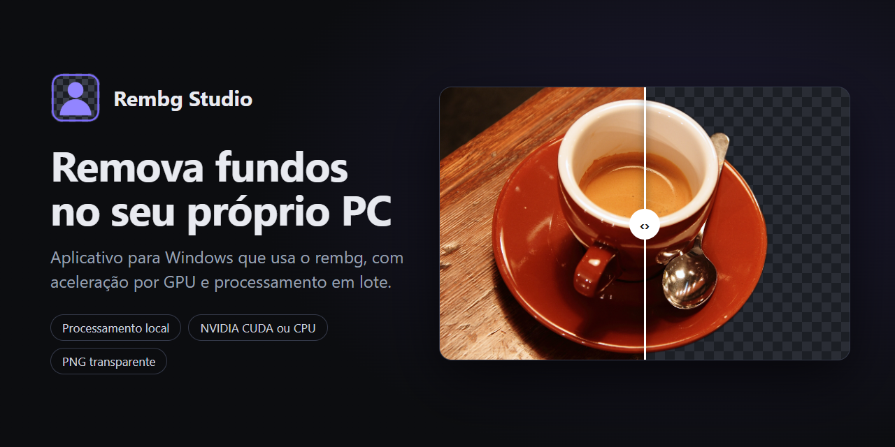
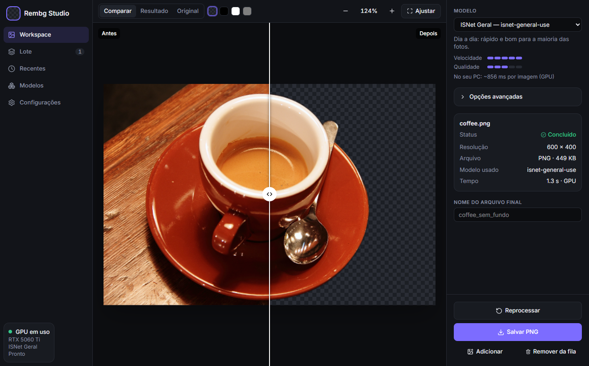
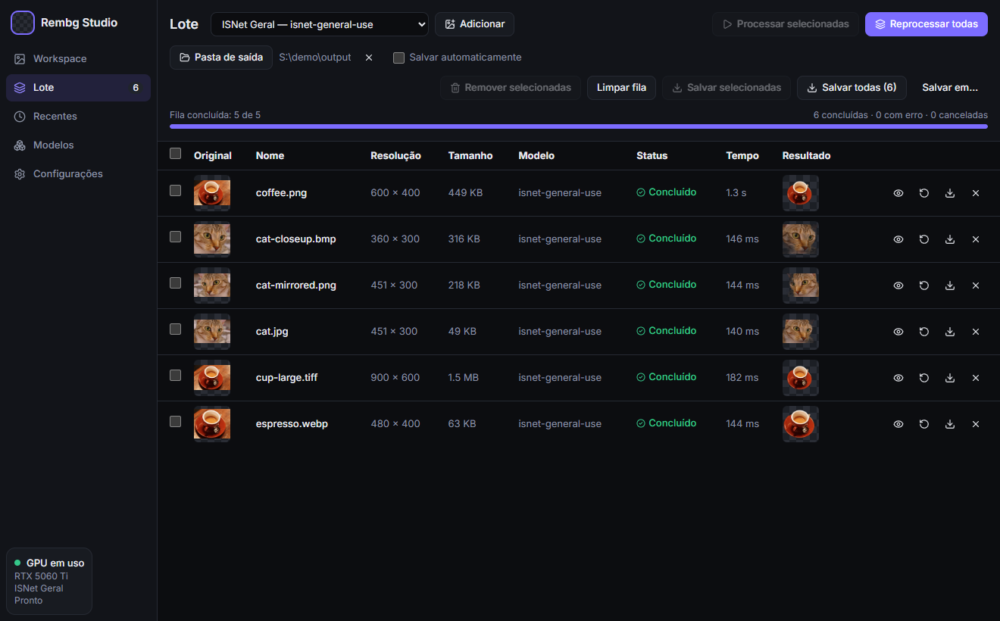
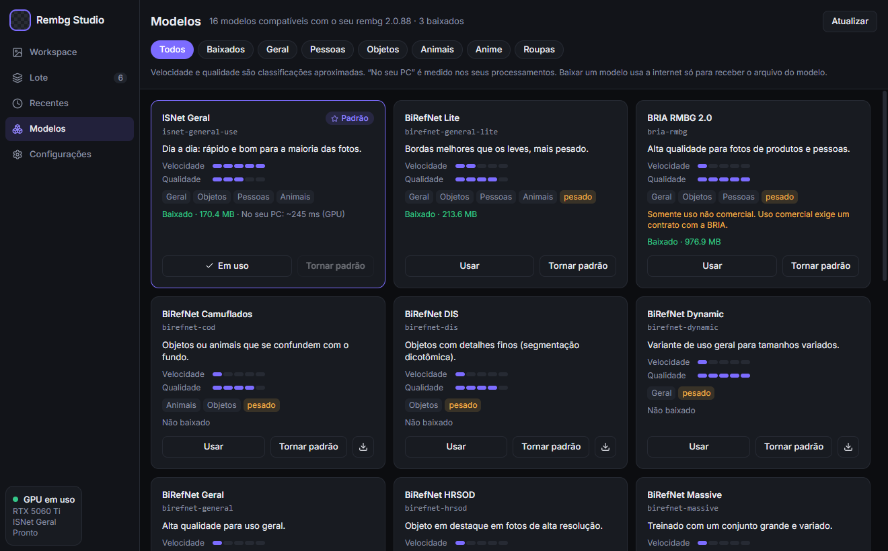
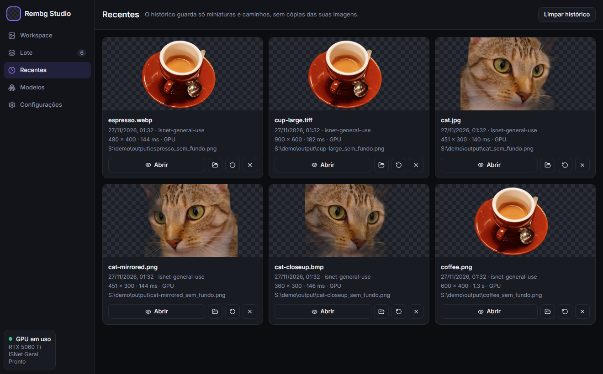
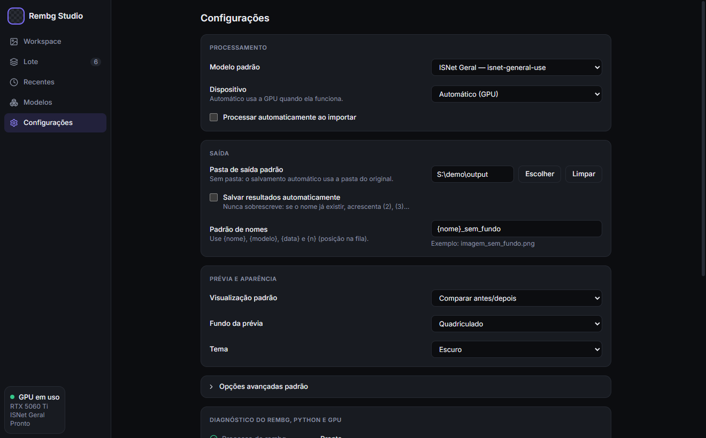
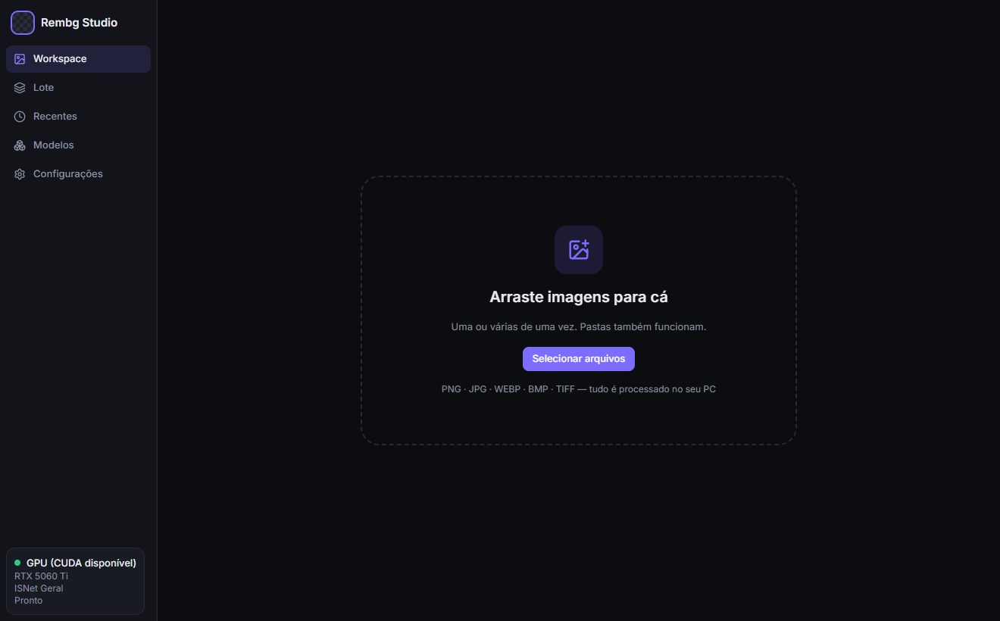

<p align="center">
  
</p>

# Rembg Studio

<!-- botoes:inicio (gerado por scripts/botoes.mjs) -->
<p align="center">
  <a href="https://github.com/odavyyy/rembg-studio/releases/download/v1.1.0/RembgStudio-Setup-1.1.0.exe"></a>
  &nbsp;&nbsp;
  <a href="https://github.com/odavyyy/rembg-studio/releases/download/v1.1.0/RembgStudio-1.1.0-portatil.exe"></a>
</p>

<p align="center">
  Windows 64 bits · precisa do <a href="#instalação">rembg instalado</a> · sem assinatura digital · estes dois .exe ainda não foram testados (<a href="https://github.com/odavyyy/rembg-studio/releases/download/v1.1.0/RembgStudio-1.1.0-win-x64.zip">o .zip, 147 MB, foi</a>) · <a href="../../releases/latest">todas as versões</a>
</p>
<!-- botoes:fim -->

<p align="center">
  <a href="README.md">English</a> · <strong>Português (Brasil)</strong>
</p>

<p align="center">
  <a href="PRIVACY.md">Privacidade</a> · <a href="TERMS.md">Condições de uso</a> · <a href="MODEL_LICENSES.md">Licenças dos modelos</a> · <a href="CODE_SIGNING_POLICY.md">Política de assinatura de código (em inglês)</a>
</p>

Aplicativo para Windows que remove o fundo de imagens usando o [rembg](https://github.com/danielgatis/rembg), com
aceleração por GPU e processamento em lote. Arraste as imagens, compare o antes e o depois e exporte PNGs
transparentes. As imagens são processadas no seu computador e não são enviadas para lugar nenhum.

> **A interface do app é em português.**
>
> **O rembg não vem junto.** Você o [instala uma vez](#instalação), e o app o encontra e usa.

## Funcionalidades

- Arraste arquivos ou uma pasta (só o primeiro nível), ou use o seletor. PNG, JPEG, WebP, BMP e TIFF.
- Controle deslizante de antes e depois, visão original e final, zoom, arraste e ajuste à tela.
- Fundos de prévia (quadriculado, preto, branco e cinza). Eles nunca mudam o arquivo exportado.
- Lote com miniatura, resolução, tamanho, modelo, status, tempo e resultado. Uma imagem é processada por vez, com
  um modelo carregado por vez.
- Cancelar, tentar de novo e reprocessar com outro modelo.
- Lista de modelos montada a partir do que a sua instalação do rembg informa.
- Opções avançadas: alpha matting, refinamento de bordas com ViTMatte, limpeza da máscara, remoção de halo
  colorido e exportar só a máscara.
- Exportação em PNG transparente. O perfil de cor (ICC) é mantido em imagens RGB.
- Pasta de saída, padrão de nomes, renomear cada imagem e salvar automaticamente. Nada é substituído sem perguntar.
- Histórico de recentes (miniaturas e caminhos, sem cópias das suas imagens).
- Página de diagnóstico com teste real da GPU.
- Atualização manual pelo próprio app, com progresso, cancelamento e conferência SHA-256.

## Telas

| Antes e depois | Lote |
|---|---|
|  |  |
| **Modelos** | **Recentes** |
|  |  |
| **Configurações** | **Tela inicial** |
|  |  |

## Requisitos

- Windows 64 bits. **Testado só no Windows 11 Pro (build 26300).**
- rembg instalado num ambiente do [uv](https://docs.astral.sh/uv/) (ou em outro ambiente Python que você indicar
  no app). O rembg 2.0.88 exige Python 3.11 ou mais novo; o ambiente testado usa 3.12.
- Para usar a GPU: placa NVIDIA com driver recente. **Testado só numa RTX 5060 Ti de 16 GB, driver 621.x.**
  Aceleração em placas AMD e Intel não é suportada nem foi testada.
- Espaço em disco para os modelos (os três usados nos testes ocupam cerca de 1,4 GB).

## Instalação

### 1. Instale o rembg

Instale o [uv](https://docs.astral.sh/uv/getting-started/installation/), por exemplo:

```powershell
winget install astral-sh.uv
```

Depois instale **uma** das duas variantes.

Com GPU NVIDIA (baixa mais de 1 GB de bibliotecas CUDA; são as versões testadas):

```powershell
uv tool install "rembg[gpu,cli]==2.0.88" --python 3.12 --with "onnxruntime-gpu[cuda,cudnn]==1.32.0"
```

Só CPU (essa variante do pacote não foi testada com o app):

```powershell
uv tool install "rembg[cpu,cli]==2.0.88" --python 3.12
```

### 2. Baixe o app

Use os botões no topo ou a página de [Releases](../../releases).

| Arquivo | O que é | O arquivo publicado foi testado? |
|---|---|---|
| `RembgStudio-Setup-1.1.0.exe` | Instalador (por usuário; você escolhe a pasta). | **Não** |
| `RembgStudio-1.1.0-portatil.exe` | Arquivo único. Descompacta a cada abertura, por isso abre um pouco mais devagar. | **Não** |
| `RembgStudio-1.1.0-win-x64.zip` | Extraia onde quiser e abra o `Rembg Studio.exe`. | **Sim** |

Os executáveis **não têm assinatura digital**, então o SmartScreen do Windows pode avisar ("Mais informações" e
depois "Executar assim mesmo"). Antes disso, confira o arquivo com o `SHA256SUMS.txt`:

```powershell
Get-FileHash .\RembgStudio-1.1.0-win-x64.zip -Algorithm SHA256
```

### 3. Primeira abertura

O app procura `%APPDATA%\uv\tools\rembg\Scripts\python.exe` e depois consulta `uv tool dir`. Se o rembg estiver em
outro lugar, use **Configurações → Diagnóstico → Escolher python.exe…**.

> Escolha apenas um `python.exe` em que você confia: o app vai executá-lo.

## Atualizações

Em **Sobre → Verificar atualizações**. Nada é verificado sozinho. O app considera só a versão estável publicada
mais recente (rascunhos, pré-lançamentos e versões antigas são ignorados), baixa o arquivo do seu tipo de
instalação, confere o tamanho e o SHA-256 com o `SHA256SUMS.txt` (e com o resumo do próprio GitHub, quando houver)
e pede confirmação antes de qualquer coisa.

| Você usa | O que a atualização faz |
|---|---|
| Portátil | Copia o `.exe` novo **ao lado** do atual, abre o novo e fecha o antigo. O antigo é mantido; apague quando quiser. Atalhos que apontam para ele precisam ser atualizados por você. |
| Instalador | Abre o instalador novo e fecha o app. Siga o instalador. |
| Pasta do ZIP | Salva o ZIP novo onde você escolher. Extraia numa pasta nova. |

Só o app é atualizado: Python, rembg, CUDA, drivers, modelos, configurações, histórico e seus arquivos não são
tocados. Resultados não salvos se perdem quando o app reinicia (há um aviso), e a instalação é recusada com a fila
ocupada. A versão 1.0.0 não tem atualizador.

Limites: as somas vêm da mesma release dos arquivos. Elas detectam download corrompido, mas **não provam autoria**
se a conta ou o repositório forem invadidos. Quando houver uma versão assinada, o atualizador também vai exigir
assinatura válida do mesmo emissor. O atualizador nunca baixou de uma release publicada de verdade.

### Como desinstalar

Instalador: **Configurações do Windows → Aplicativos → Rembg Studio → Desinstalar**. Portátil ou ZIP: apague os
arquivos. Nos dois casos seus dados ficam em `%APPDATA%\Rembg Studio` até você apagar a pasta; os modelos ficam em
`%USERPROFILE%\.rembg`.

## GPU e CPU

No Windows, o ONNX Runtime não encontra sozinho as DLLs do CUDA instaladas pelo pip. O app adiciona essas pastas
ao `PATH` **somente do processo dele**, sem alterar seu ambiente Python nem o Windows. (O comando `rembg` no
terminal ainda pode usar a CPU no mesmo computador; isso está fora do app.)

- **Configurações → Testar GPU de verdade** carrega um modelo e informa onde ele rodou de fato. Aparecer "CUDA" na
  lista não prova que a GPU funciona.
- Se a GPU não puder ser usada, o app avisa e usa a CPU, que é mais lenta. O modo "Somente CPU" foi testado na
  instalação com GPU.
- Modelos pesados ficam muito mais lentos quando outros programas ocupam a memória da placa. No PC de teste, com a
  maior parte dos 16 GB em uso, modelos grandes levaram de alguns segundos a mais de um minuto por imagem.

## Modelos

Com os extras `gpu,cli`, o rembg 2.0.88 oferece **16 modelos locais**, que o app lista:

`isnet-general-use` (padrão) · `isnet-anime` · `u2net` · `u2netp` · `u2net_human_seg` · `u2net_cloth_seg` ·
`silueta` · `birefnet-general` · `birefnet-general-lite` · `birefnet-portrait` · `birefnet-dis` ·
`birefnet-hrsod` · `birefnet-cod` · `birefnet-massive` · `birefnet-dynamic` · `bria-rmbg`

O `birefnet-general-fp16` só aparece com o extra `fp16` do rembg (não testado). Ficam de fora, de propósito, os
modelos que pedem arquivo próprio ou pontos marcados (`u2net_custom`, `dis_custom`, `ben_custom`, `sam`) e os
serviços na nuvem (`withoutbg`, `atlascloud`).

**Nos testes só rodaram `isnet-general-use`, `birefnet-general-lite` e `bria-rmbg`.** As barras de velocidade e
qualidade do app são notas aproximadas, não medições. O `u2net_cloth_seg` devolve três recortes empilhados (parte
de cima, parte de baixo e inteiro), por isso o antes e depois não fica disponível para ele.

### Como baixar outros modelos

Um modelo que falta é baixado no primeiro uso ou pela página **Modelos** (esse botão não foi testado). Pelo
terminal:

```powershell
rembg d isnet-anime
```

Eles ficam em `%USERPROFILE%\.rembg\models` e são baixados dos endereços definidos pelo rembg.

### Licenças dos modelos: leia antes de usar comercialmente

**Nenhum modelo está incluído no projeto nem nas releases.** Cada um tem licença própria, que não muda com a licença
MIT do rembg nem com a do app.

- ⚠️ **`bria-rmbg` (RMBG 2.0): somente uso não comercial** (CC BY-NC 4.0, segundo a página do modelo). **Uso
  comercial exige um contrato com a BRIA.**
- Vários modelos **não declaram a licença dos pesos**, o que **não** quer dizer uso livre. Isso inclui o padrão,
  `isnet-general-use`.

Veja a tabela completa em [MODEL_LICENSES.md](MODEL_LICENSES.md). Isto não é aconselhamento jurídico.

## Limitações

- O **alpha matting** roda na CPU, em resolução cheia, e usa muita RAM: cerca de 4 GB a mais numa foto de 12 MP no
  PC de teste. O app recusa imagens **acima de 25 MP**, ou um limite menor se houver pouca RAM livre, em vez de
  travar o computador. O ViTMatte não entra nesse limite.
- Imagens acima de 250 megapixels são recusadas.
- Só o primeiro quadro de arquivos com vários quadros é processado. Imagens de 16 bits viram 8 bits.
- Os PNGs exportados **não** mantêm os metadados EXIF. O perfil ICC só é mantido quando a origem é RGB; imagens
  CMYK são convertidas sem gerenciamento de cor.
- **Resultados não salvos são perdidos ao fechar o app:** o cache temporário é apagado na próxima abertura (até lá
  os arquivos continuam em `%APPDATA%\Rembg Studio\cache`). Ligue o salvamento automático para mantê-los.
- Cancelar reinicia o processo do rembg, e a imagem seguinte recarrega o modelo.
- A fila aceita até 1000 imagens, e o histórico guarda até 300 itens.
- A interface existe apenas em português.

## Privacidade e dados locais

As imagens são processadas no seu computador. O app não tem contas, análise de uso nem anúncios, e o mantenedor não
recebe dados. A rede só é usada quando você pede: verificar ou baixar uma atualização, e o rembg baixar um modelo
que você escolheu. O app pede ao ONNX Runtime que desligue a telemetria no processo que ele abre. O histórico, os
**caminhos dos arquivos** e as **miniaturas dos resultados** ficam sem criptografia em `%APPDATA%\Rembg Studio`.
Detalhes, medições e os limites delas estão na [Política de Privacidade](PRIVACY.md).

## Assinatura de código

As versões **não têm assinatura digital** e nenhum pedido de assinatura foi aprovado. Veja a
[política de assinatura de código](CODE_SIGNING_POLICY.md) (em inglês).

## O que foi testado

Versão 1.1.0, num único computador (veja os requisitos).

**No pacote compilado pelo GitHub:** o `RembgStudio-1.1.0-win-x64.zip` passou nas 33 verificações do app
(`tests/e2e.mjs`), com o rembg e a GPU reais. O hash conferiu, e os 79 arquivos eram idênticos aos de uma
compilação local do mesmo commit. Sem pedir atualização, nenhum acesso externo foi observado ao processar com um
modelo já baixado.

**Atualizador** (`tests/update-e2e.mjs`, 39 verificações), em compilações locais anteriores ao último commit da
versão, que mudou só documentos, autoria e comentários do workflow:

- *Real:* o portátil 1.1.0 baixou uma versão de teste 1.2.0 servida no próprio PC, conferiu, abriu a nova e saiu;
  o arquivo antigo, as configurações, o histórico e um resultado salvo ficaram iguais, sem processo Python sobrando.
  O ambiente do rembg, o Python do uv, os modelos, os dados do app, o ajuste do CUDA e o driver não mudaram.
- *Simulado:* o servidor de atualizações (sem versão nova, versão antiga, rascunho, pré-lançamento, erros de rede,
  cancelamento, download incompleto, hash errado, arquivo inválido, redirecionamento e outros) e as janelas do
  Windows, inclusive a confirmação no teste real do portátil.

**Outras simulações:** as janelas de abrir e salvar, e o arrastar e soltar (evento injetado no Chromium).

**Não testado:** o instalador e o portátil publicados; a atualização de uma cópia instalada; baixar de uma release
publicada de verdade; assinatura com uma versão assinada; as etapas de assinatura do workflow; o ViTMatte; baixar
modelo pelo app; os outros 13 modelos; alguns botões do lote; escolher outro `python.exe`; atalhos de teclado; o
tema "Igual ao Windows"; instalação só com CPU; outros computadores, placas e versões do Windows.

## Compilar a partir do código

Precisa do Node.js 22.12 ou mais novo.

```powershell
git clone https://github.com/odavyyy/rembg-studio.git
cd rembg-studio
npm ci
npm start
```

| Comando | O que faz |
|---|---|
| `npm run dev` | Servidor de desenvolvimento com recarga, mais o Electron. Reinicie após mudar `electron/`. |
| `npm run build` | Confere os tipos e compila. |
| `npm run dist` | Gera instalador, portátil e ZIP em `release/`. |
| `npm run notices` | Gera de novo o `THIRD_PARTY_NOTICES.md`. |
| `npm run art` | Gera de novo o `docs/banner.png`. |
| `node scripts/botoes.mjs` | Gera de novo os botões de download e os links no topo dos READMEs. |
| `node tests/unit.mjs` | Regras do atualizador (não precisa de GPU). |
| `node tests/e2e.mjs <pasta-vazia>` | Testes de ponta a ponta. Passe um `.exe` empacotado como segundo argumento para testá-lo. |
| `node tests/update-e2e.mjs <pasta-vazia> release <portátil-seguinte.exe>` | Testes do atualizador em pacotes. |
| `node tests/netaudit.mjs <pasta-vazia>` | Observa o uso de rede do app. |

- Se o binário do Electron faltar depois do `npm ci`, rode `node node_modules/electron/install.js`.
- **Caminhos longos:** o NSIS falha com `!include: could not open file` se o caminho do projeto for longo. Compile
  a partir de uma pasta curta, como `C:\src\rembg-studio`.
- O `npm audit` aponta alertas moderados no `minimatch`, usado pelo electron-builder. É ferramenta de compilação e
  não vai dentro do app; a correção oferecida pelo npm é um rebaixamento com mudanças incompatíveis.
- Ao gerar o instalador, o electron-builder executa um componente temporário do NSIS que só grava o desinstalador.
- O `npm run dist` impede o electron-builder de incluir o `elevate.exe`.
- Os testes precisam do rembg com GPU NVIDIA e dos três modelos citados já baixados. Feche o app antes. A pasta
  informada é apagada, e o teste recusa uma pasta não vazia que ele não criou.

## Estrutura do projeto

```text
python/worker.py   processo que chama o rembg; JSON por stdin/stdout, sem porta de rede
electron/          janela, comunicação interna, fila, exportação, histórico, atualizador
src/               interface em React + Tailwind
shared/types.ts    tipos usados pelos dois lados
scripts/           compilação, arte, avisos e botões
tests/             testes
docs/              banner, botões, telas e notas das versões
```

A interface roda isolada, sem acesso ao Node.js, e fala com o processo principal por uma ponte pequena. As imagens
chegam a ela por um protocolo próprio, que só entrega arquivos que o app já conhece.

## Autoria

O Rembg Studio é de [odavyyy](https://github.com/odavyyy), único dono do código e mantenedor.

Foi desenvolvido com a ajuda do [Claude](https://www.anthropic.com/claude) (Anthropic): a maior parte do código, da
documentação e da arte foi escrita pelo Claude, a partir dos requisitos definidos pelo dono. O Claude é uma
ferramenta de IA usada no desenvolvimento, não é dono nem mantenedor. Revise o código como faria com qualquer
código de terceiros.

## Licença e créditos

Código sob a [Licença MIT](LICENSE), © 2026 odavyyy. Ela não muda as licenças do rembg, dos modelos nem de outros
componentes: veja os [avisos de terceiros](THIRD_PARTY_NOTICES.md).

- O [rembg](https://github.com/danielgatis/rembg), de Daniel Gatis, faz a remoção de fundo. Este é um projeto
  independente, sem vínculo nem endosso do autor do rembg ou dos autores dos modelos.
- As fotos de exemplo das telas e do banner vêm com o
  [scikit-image](https://github.com/scikit-image/scikit-image): *coffee* (Rachel Michetti, cortesia do Pikolo
  Espresso Bar, CC0) e *chelsea* (Stefan van der Walt, CC0).
